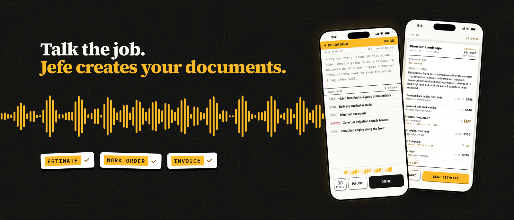
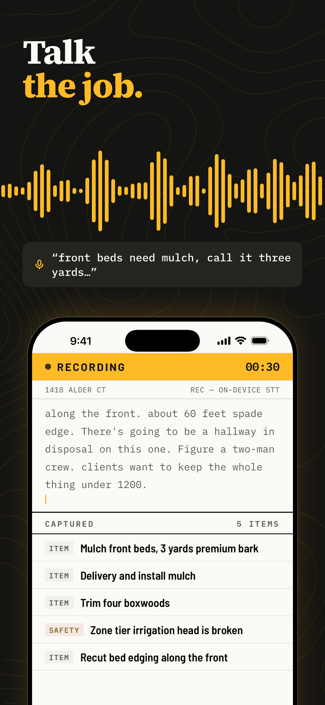
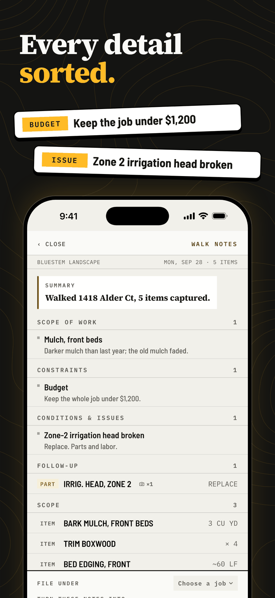
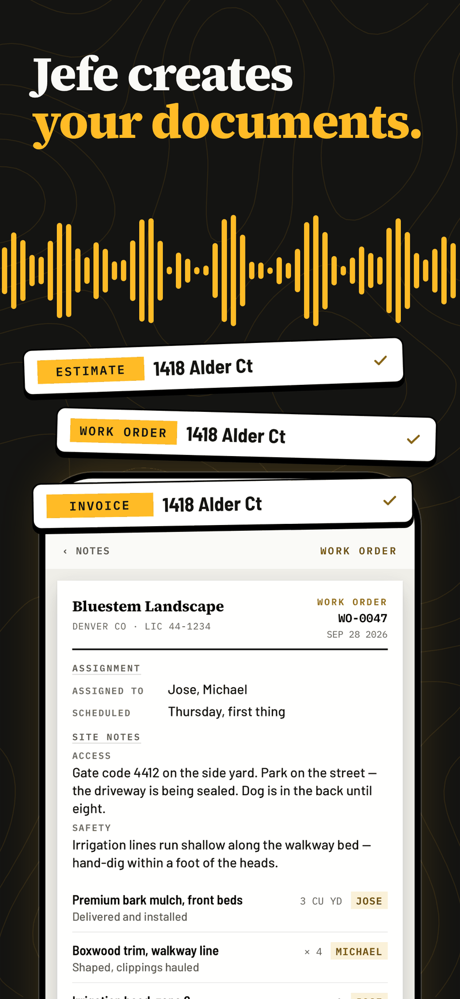
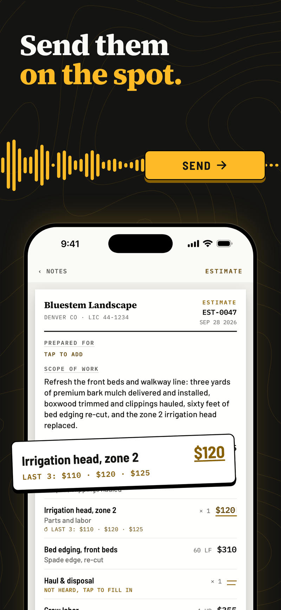
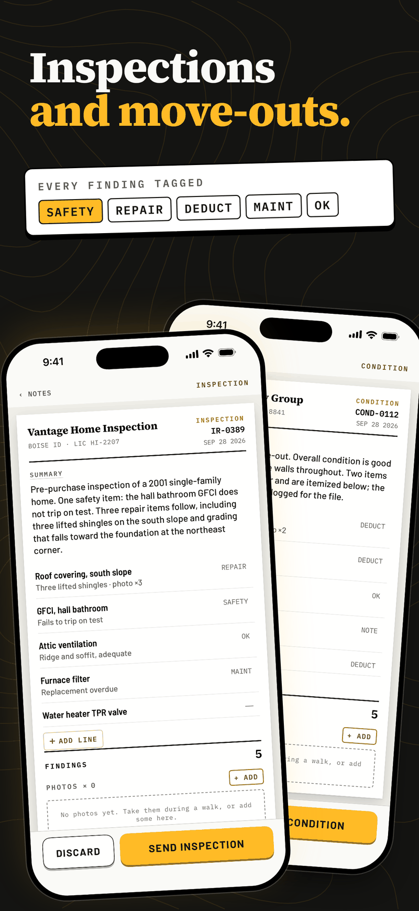
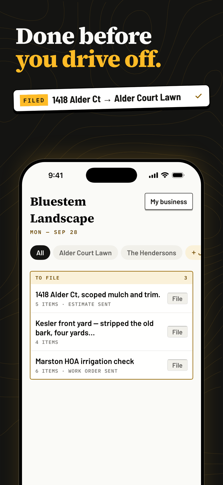
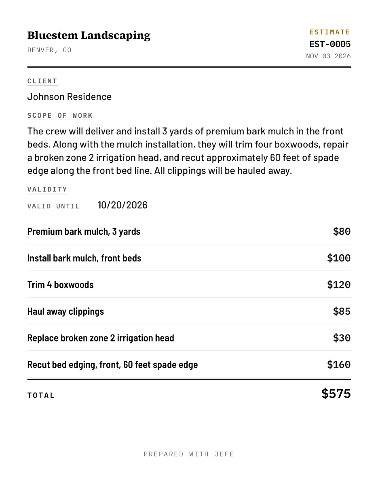
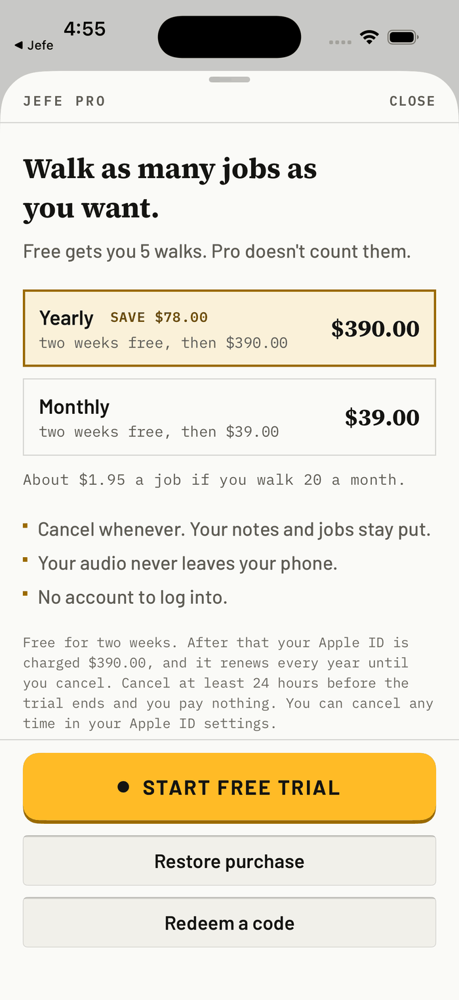

# Jefe: Voice Estimate Maker

**Walk the job, talk it through, and send a finished estimate before you drive off.**

Jefe is an iPhone app for people in the trades. You record yourself walking a job site, and Jefe turns what you said into a clean estimate, invoice, work order or inspection report.

[**Download on the App Store →**](https://apps.apple.com/us/app/jefe-voice-estimate-maker/id6761315709)

> This repo is a public overview of the product. The app's source code lives in a private repository in the [damsac](https://github.com/damsac) organization.

  
  
  
  

---

## The problem

<!-- TODO: this section is my framing, not from your resume. Replace it with what you actually heard from contractors. -->
Contractors size up a job by walking it: looking at the space, measuring, and talking with the client. Then they go home and write it all up. That write-up happens at night, from memory, and it is slow. Estimates go out late, details get missed, and jobs are lost to whoever quoted first.

## What Jefe does

1. **Talk the job.** Hit Start Walk and talk through the site the way you already do. Speech-to-text runs on the phone, and line items appear as you speak, with safety issues tagged separately.
2. **Get sorted notes.** When you finish, the walk becomes notes grouped into scope of work, constraints like the client's budget, conditions and issues, and follow-ups such as parts to order. Photos taken during the walk stay attached.
3. **Price it fast.** For each line item, Jefe shows the last three prices you charged, so pricing is a tap. Anything you didn't say out loud is marked *Not heard, tap to fill in*. Jefe never makes up a number.
4. **Make the documents.** One walk becomes an estimate, a work order with crew assignments plus site access and safety notes, or an invoice, all with your business details on them.
5. **Send and file it.** Send the document from the job site, then file the walk under the right job so everything for that client is in one place.

### Beyond estimates

The same walk can also produce home inspection reports and move-out condition reports, with every finding tagged as Safety, Repair, Deduct, Maintenance or OK.

  
  

Built for landscaping, plumbing, electrical, HVAC, home inspection and similar trades.

### Sample output

A real estimate generated by Jefe for a demo landscaping business: [sample-estimate.pdf](examples/sample-estimate.pdf)

## My role

**Co-founder & Product Lead** (January 2026 – present)

I own the product: what we build, how it looks and works, how it's priced, and how we get it in front of contractors.

- Took Jefe from beta to a production App Store release, shipping **100+ builds in 5 weeks**. Launched on the App Store in **October 2026**.
- Led UI/UX design, translating how people in the trades actually work into features that make sense to them.
- Designed pricing and built subscription billing, usage limits and a free tier to turn the beta into a paid product.
- Run go-to-market through paid ads, the App Store and contractor groups, and track App Store views through paid conversion weekly to decide where to spend on ads.

## Product decisions

<!-- TODO: check each "why" below and rewrite it in your own words if the real reason was different. -->

**Audio never leaves the phone.**
Speech-to-text runs on the device, so the recording itself stays on the phone. An LLM then turns the transcript into line items.
*Why:* contractors are recording inside clients' homes and businesses. Keeping the audio on the phone makes that an easy yes.

**Flag it, don't guess it.**
When a price or quantity wasn't said, Jefe marks it *Not heard* instead of filling in a plausible number. Price suggestions come only from the contractor's own last three prices for that item.
*Why:* a wrong number on an estimate costs a contractor money or credibility. A visible blank costs them five seconds.

**Talk first, type later.**
The core input is a voice recording made while walking the site, not a form.
*Why:* that's how the work already happens. People in the trades rarely want to type on a phone at a job site.

**Free walks, then a simple subscription. No account.**

The first 5 walks are free. Jefe Pro removes the limit, billed monthly or yearly with a two-week free trial. There's no account to create, and cancelling keeps all notes and jobs.
*Why:* contractors need to see one real estimate come out of their own walk before they'll pay for it, and a sign-up form is where many of them would quit.

 

## Making it reliable in the field

Job sites are hard on a phone app. Recent releases focused on what breaks in the real world:

- Recordings survive interruptions from phone calls.
- Recording recovers from Bluetooth or headset disconnects and microphone drops.
- The app reconnects to the server when a walk starts on a weak connection.
- Error messages say clearly when a document failed or an edit wasn't saved.

## Tech at a glance

- iPhone app (iOS 17 or later)
- On-device speech-to-text
- An LLM that turns transcripts into structured, tagged line items and flags anything uncertain
- Subscription billing with usage metering and a free tier

<!-- TODO: add the main frameworks and services you use (for example SwiftUI, your backend, your LLM provider, StoreKit), only if you're comfortable sharing them. -->

## Team

- **Isaac Wallace-Menge**, Co-founder & Product Lead · [LinkedIn](https://www.linkedin.com/in/isaac-wallace-menge/) · [GitHub](https://github.com/sacmeng)
- <!-- TODO: co-founder name, role and link --> Co-founder

## Links

- [Jefe on the App Store](https://apps.apple.com/us/app/jefe-voice-estimate-maker/id6761315709)
- <!-- TODO: your personal site link once it's live -->
